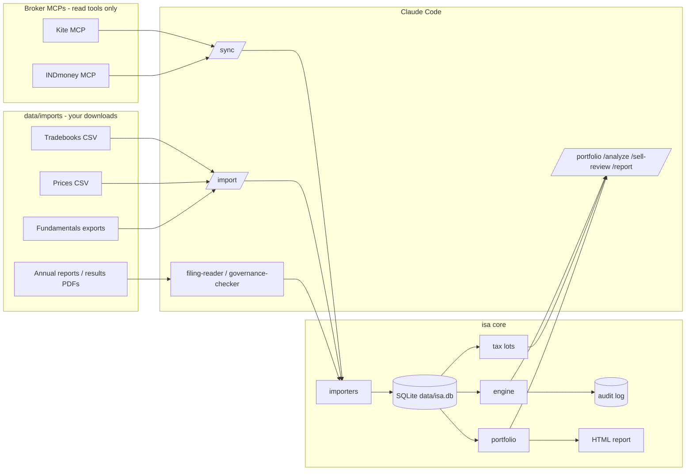

# Architecture

## Principle: code decides, Claude explains

| Layer | Responsibility | Never does |
|---|---|---|
| **Claude Code workspace** (`CLAUDE.md`, `.claude/`) | Calls broker MCP read tools, routes imports, extracts facts from PDFs (pending until confirmed), presents engine JSON in plain language, records your decisions | Changes a label or number, places orders, fetches NSE/BSE automatically |
| **Core** (`src/isa/`, via `tools/isa.py`) | Validates and stores data, builds tax lots, scores stocks, applies triggers and caps, renders the report, writes the audit log | Calls an LLM or a broker order endpoint |

Because the core is deterministic and point-in-time, the same data and config always give the same label, and the signal stores an `inputs_hash`. That is what makes the scoring testable and, later, backtestable.

## Data flow

## Modules

| Module | Purpose |
|---|---|
| `storage/db.py` | SQLite schema (versioned with `PRAGMA user_version`), migrations, security master helpers |
| `importers/broker.py` | Holdings snapshots and delivery trades from Kite, INDmoney and 5paisa JSON or CSV. Intraday and derivative rows are skipped; trade IDs are de-duplicated |
| `importers/market.py` | Daily prices (including indices) and the sector/industry list |
| `importers/facts.py` | Fundamental and shareholding facts in long format, checked against a metric catalogue. LLM-extracted facts need a `source_ref` and stay unconfirmed until you approve them |
| `engine/base.py` | Evidence types and the point-in-time `Data` view: only facts published on or before the evaluation date, and only confirmed LLM facts |
| `engine/fundamentals.py` | Block (c): growth, ROE, ROCE, margins, leverage, coverage, cash conversion, FCF, working capital, payout |
| `engine/governance.py` | Block (d): pledge, promoter and institutional trends, audit opinion, auditor resignation, related-party transactions, dilution. Produces vetoes |
| `engine/valuation.py` | Block (e): P/E, P/B, EV/EBITDA percentiles vs own history; P/E vs peers; PEG; 2-stage DCF range |
| `engine/technicals.py` | Block (f): DMAs, relative strength, drawdown, volume. Timing advice only |
| `engine/scoring.py` | Composite, label, confidence, "why", sell triggers, thesis checks, signal recording |
| `tax/` | FIFO lots per account, STCG/LTCG term, per-lot estimates, FY exemption usage |
| `portfolio/` | Positions across brokers, weights, sector exposure, caps, reconciliation |
| `report/` | Self-contained HTML (escaped, no scripts, light and dark) |
| `audit/` | Append-only, SHA-256 hash-chained events; database triggers block UPDATE and DELETE |
| `service.py` / `cli.py` | Orchestration and the JSON CLI |

## Scoring summary

- Each block scores from −2 to +2: the mean of its evidence points.
- **Composite:** the weighted mean of the blocks with at least 30% of their inputs.
- **Label cut-offs:** 1.0 / 0.4 / −0.4 / −1.0. Governance vetoes cap BUY/ACCUMULATE at HOLD.
- **Sell triggers:** `thesis_broken` and `loss_with_weakening_fundamentals` force SELL; `valuation_stretch` forces at least TRIM.
- **Confidence** = coverage × completeness × agreement × freshness.

Full details are in `.claude/skills/stock-analysis/02-scoring-rubric.md`.

## Database tables

| Table | Contents |
|---|---|
| `security` | Symbol, ISIN, name, sector, industry, index flag |
| `watchlist` | Stocks you follow but do not hold |
| `holding_snapshot` | Broker holdings by source and date |
| `trade` | Delivery trades, from which the tax lots are built |
| `price_daily` | Daily candles |
| `fundamental_fact` | One value per (symbol, metric, period, source), with `published_at`, `extracted_by` and `confirmed` |
| `thesis_condition` | Your checkable conditions |
| `signal` | Every computed label, with its full JSON payload and `inputs_hash` |
| `audit_event` | The hash-chained log |
| `import_log` | One row per import |

## Extending

- **New block** (macro, sector, events): add a module under `engine/` returning a `BlockResult`. Register it in `scoring._blocks`, and remove its name from `PHASE2_BLOCKS`. Its weight already exists in `config/weights.toml`.
- **5paisa REST client:** add it under `src/isa/` with a hard allowlist of read endpoints. `tools/security_guards.py` fails the build if order-endpoint names appear in code.
- **New metric:** add it to `importers/facts.METRICS`, then use it in a block.
