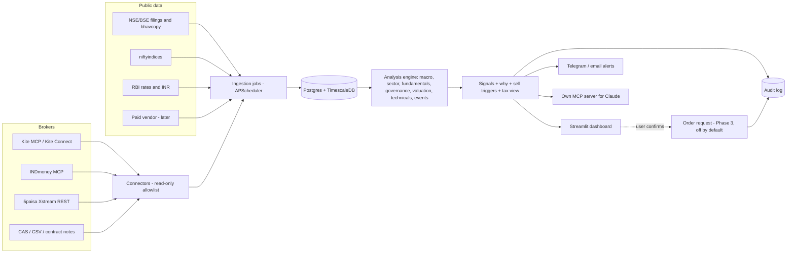

# India Stock Analyzer: Feasibility and Design

**Status:** research and design only. No feature code has been written. Waiting for user approval.
**Date of research:** 2026-11-14. Every link was checked on that date unless marked otherwise.
**Scope:** a personal-use tool that analyses Indian equities (NSE/BSE) for a long-term investor (no intraday or same-day trading) who uses Zerodha Kite, 5paisa and INDmoney.

**How to read this report**
- **[V]** = verified fact, with the official source linked.
- **[S]** = secondary source, such as a broker blog or third-party page. Treat it with care.
- **[A]** = assumption or design judgement, not a sourced fact.
- **[U]** = not verified: the source was blocked or not found. These items are listed again as open questions.

**User direction (2026-11-14):** "GO with MCP to fetch records". As a result, broker records (holdings, positions, orders, P&L) are fetched first through each broker's **official MCP server**. Direct REST APIs and file imports remain as fallbacks (see §1.4 and DECISIONS D-02).

---

## 0. Executive summary

1. All three brokers now have an **official MCP server** for an individual's own account:
   - Kite: hosted, free.
   - INDmoney: hosted, read-only, OAuth 2.1, free.
   - 5paisa: runs locally, free, and **can place orders**.
2. Zerodha and 5paisa also have documented REST and WebSocket APIs. INDmoney has **no public REST API** that I could find, so its MCP is the only programmatic route.
3. SEBI's retail algo framework applies to **orders** placed through APIs: static IP, OAuth plus 2FA, and exchange-issued algo IDs. Since 1 April 2026 it applies to all brokers. A design that **never places orders automatically**, and in the MVP places no orders at all, keeps the tool out of almost all of that.
4. Using the tool only for yourself does not meet SEBI's definition of an Investment Adviser, which requires advice given "for consideration … to clients". **Showing the signals to other people** is the line to avoid. Under the Research Analyst rules, publishing buy/sell/hold recommendations can require registration.
5. The hard part is **licensed fundamentals data**, not prices. No free, licence-clear fundamentals API was verified. The MVP uses exchange filings plus manual personal-use exports, and treats a paid vendor as a later decision.
6. **Verdict: GO-WITH-CONDITIONS** (§7).

---

## 1. Phase 1: Broker access

### 1.1 Zerodha Kite Connect (REST and WebSocket)

| Item | Finding | Source |
|---|---|---|
| Public API, usable by individuals | Yes. Needs "An active Zerodha trading account" with 2FA TOTP. An `api_key` and `api_secret` pair is issued. [V] | https://kite.trade/docs/connect/v3/ |
| Pricing | **Personal (Free)**: "Full fledged order, GTT, alerts management", "Margin computation, portfolio management". **Connect**: "Full suite of APIs with realtime WebSocket streaming and historical candle data for ₹ 500 / month". [V] An April 2025 blog post quoted ₹2000 for data. The product page's ₹500 figure is taken as current. [S] | https://zerodha.com/products/api/ · https://zerodha.com/z-connect/updates/free-personal-apis-from-kite-connect |
| Auth flow | 1. Redirect to `https://kite.zerodha.com/connect/login?v=3&api_key=…`. 2. The `request_token` returns to the redirect URL ("lifetime is only a few minutes"). 3. Compute checksum = SHA-256(api_key + request_token + api_secret). 4. POST `/session/token` to get the `access_token`. [V] | https://kite.trade/docs/connect/v3/user/ |
| Daily token expiry | The access token "expire[s] at 6 AM on the next day (regulatory requirement)". [V] **The user must log in once a day.** | same |
| Holdings, positions | `GET /portfolio/holdings`, `GET /portfolio/positions` [V] | https://kite.trade/docs/connect/v3/portfolio/ |
| Orders | Varieties `regular`, `amo`, `co`, `iceberg`, `auction`. `market_protection` is available for MARKET and SL-M orders. [V] | https://kite.trade/docs/connect/v3/orders/ |
| GTT / stop-loss | `/gtt/triggers`, with "single" and "two-leg" (OCO) types. LIMIT orders only. [V] | https://kite.trade/docs/connect/v3/gtt/ |
| Historical candles | `GET /instruments/historical/:token/:interval`, from minute to day. "spanning back several years". Per-interval lookback limits: [U] | https://kite.trade/docs/connect/v3/historical/ |
| Quotes | `/quote` (500 instruments per call), `/quote/ohlc` and `/quote/ltp` (1000 per call). The instrument dump is "generated once everyday". [V] | https://kite.trade/docs/connect/v3/market-quotes/ |
| WebSocket | "up to 3000 instruments on a single WebSocket connection"; "upto 3 websocket connections" per API key. [V] | https://kite.trade/docs/connect/v3/websocket/ |
| Rate limits | Quote 1 req/s; historical 3 req/s; orders 10 req/s; everything else 10 req/s. 400 orders/min, 5000 orders/day, 25 modifications per order. [V] | https://kite.trade/docs/connect/v3/exceptions/ |
| SDKs | Python (pykiteconnect), Java, Node.js, .NET, Go, Rust, PHP, C++ [V] | https://zerodha.com/products/api/ |
| Sandbox | None found. [U] | — |
| Terms limits | Personal use is "a private interface exclusively for customising personal trading and investment experience". "The APIs are not meant for placing fully automated trades (without manual intervention)." Live market data "cannot be displayed to the public at large". No "permanent copies" or databases built for redistribution. Logs must be kept "for at least 5 years". [V] | https://kite.trade/terms |

**Kite MCP (official)**

| Item | Finding | Source |
|---|---|---|
| Endpoint | Hosted at `https://mcp.kite.trade/mcp`. Self-hosting is also possible (Go, MIT licence). [V] | https://github.com/zerodha/kite-mcp-server |
| Tools | `get_holdings`, `get_positions`, `get_mf_holdings`, `get_orders`, `get_trades`, `get_margins`, `get_quotes`, `get_ohlc`, `get_historical_data`, `search_instruments`, GTT tools, and order tools. [V] | same |
| Hosted restrictions | The README says the hosted endpoint "excludes potentially destructive trading operations". Zerodha's May 2025 post says it is read-only "except for GTT orders". **The two sources conflict on which tools the hosted endpoint exposes today** [U]. Self-hosting supports `EXCLUDED_TOOLS` to remove order tools. [V] | README above · https://zerodha.com/z-connect/featured/connect-your-zerodha-account-to-ai-assistants-with-kite-mcp |
| Cost and auth | "completely free of charge". Login goes through Kite's own 2FA flow. [S/V] | same post |

### 1.2 5paisa Xstream API

| Item | Finding | Source |
|---|---|---|
| Public API, usable by individuals | Yes. "Retail and Professional Traders" are listed as eligible. Keys come from the Xstream dashboard. [V] | https://xstream.5paisa.com/ |
| Pricing | "all trading APIs at absolutely free of any charges". Paid "Exclusive Plans for Ultra Traders" are available by contact. Historical data fee: [U] | same |
| Auth flow | OAuth web login with client code, PIN and OTP/TOTP. The `RequestToken` returns to ResponseURL, valid "60 min". POST `GetAccessToken` to exchange it. [V] | https://xstream.5paisa.com/dev-docs/user-authentication-system/oauth-login · …/access-token |
| Daily token expiry | "Token expires every day at 11:59 PM." [V] | …/access-token |
| Holdings | `POST …/V3/Holding` [V] | https://xstream.5paisa.com/dev-docs/portfolio-management-system/holdings |
| Positions, orders | Documented, including stop-loss, bracket, cover and "VTT" (trigger-price) orders. Exact GTT equivalence: [U] | https://xstream.5paisa.com/ · https://github.com/OpenApi-5p/py5paisa |
| Historical candles | `GET /V2/historical/{Exch}/{ExchType}/{ScripCode}/{Interval}`, 1m to 1d. Intraday is capped at 6 months per request. Daily has "no size limit". [V] | https://xstream.5paisa.com/dev-docs/market-data-system/historical-candles |
| WebSocket | `wss://openfeed.5paisa.com/…`, with MarketFeedV3, MarketDepth and OrderTradeConfirmations. [V] | https://xstream.5paisa.com/dev-docs/market-data-system/web-socket |
| Rate limits | **Sources conflict.** The FAQ says "600 order requests/minute … other APIs … 50 requests/minute". Other cards on the same page say 10 or 25 orders/s, 10000/day, OHLC 25 req/s and 200 WebSocket subscriptions. [V, inconsistent] | https://xstream.5paisa.com/ |
| SDKs | Python `py5paisa`, Java, C#, Node.js [V] | https://github.com/OpenApi-5p/py5paisa |
| Sandbox, static IP, terms | Not found [U]. Terms are at https://www.5paisa.com/terms-and-conditions, which I did not read. [U] | — |

**5paisa MCP (official)**: "free for all existing 5paisa customers". It is **local**: you clone `github.com/5paisa/5paisa_MCP` and run it with Node, and it supports Claude Desktop. Its tools can "place orders, check your portfolio, or fetch market data". The setup guide stores the **TOTP secret and PIN in a plain local `creds.json`** [V], which is a security concern. See D-05. Sources: https://www.5paisa.com/technology/mcp-ai-trading-assistant · https://www.5paisa.com/mcp-ai-trading-assistant-setup-for-mac · https://tradebetter.5paisa.com/t/introducing-5paisa-mcp-your-ai-companion-for-smarter-portfolio-management/310 (17 June 2025).

### 1.3 INDmoney (INDstocks)

| Item | Finding | Source |
|---|---|---|
| Public REST API | **None found.** There is no developer link on the site or pricing page. `developer.indmoney.com` and `docs.indstocks.com` do not resolve (DNS fails). `api.indstocks.com` returns 404. [V for the absence of evidence; this does not prove no API exists] | https://www.indmoney.com/ · https://www.indmoney.com/pricing |
| Official MCP | `https://mcp.indmoney.com/mcp`. "Read-only by design". It cannot "place trades, transfer money, redeem investments, or change any setting". [V] | https://www.indmoney.com/mcp |
| MCP capabilities | Net worth; per-asset holdings with P&L and XIRR; OHLC candles; live prices and depth; option chain; watchlist and SIPs; mutual funds; US equities. A transaction or trade-history tool: [U] | same |
| Auth and cost | "OAuth 2.1 with PKCE", signing in with mobile, OTP and MPIN. "free for INDmoney customers". Supported clients: "primarily means Claude". [V] | same |
| Entity | INDstocks Private Limited, SEBI broker INZ000305337, **CDSL DP ID 12095500** [V]. That means holdings should also appear in a CDSL CAS statement [A]. | https://www.indmoney.com/ |

### 1.4 Fallbacks when a broker has no usable API or MCP

The fallbacks follow one design rule: **every connector writes the same canonical record** (holding lot, trade, corporate action). Any source can then stand in for another.

1. **CDSL/NSDL Consolidated Account Statement (CAS) PDF import**: one statement covers all demat accounts. It is the reconciliation "source of truth" for quantities across brokers. [A; the CAS format still needs a spike]
2. **Broker tradebook or P&L CSV import** (Kite Console, 5paisa, INDmoney): gives buy dates and prices for FIFO tax lots. [A; the export paths for INDmoney were not verified, U]
3. **Contract-note PDF parsing**: the last resort for trade dates and prices.
4. **Claude-mediated sync**: if a hosted MCP rejects a non-Claude OAuth client, the user runs a "sync" prompt in Claude Code. Claude reads the broker MCP and writes the records into this tool through the tool's own MCP server (`import_holdings`). [A]

### 1.5 Comparison and integration order

| | Kite | 5paisa | INDmoney |
|---|---|---|---|
| REST API for individuals | Yes | Yes | **No (not found)** |
| Official MCP | Hosted, plus self-host | Local only | Hosted |
| MCP read-only | Hosted: mostly (conflict on GTT); self-host can exclude order tools | **No**: places orders | **Yes** |
| Cost | Personal free; Connect ₹500/mo (historical and WebSocket) | Free | Free |
| Token expiry | 06:00 next day | 23:59 same day | OAuth refresh behaviour [U] |
| Historical candles | Connect plan, or the MCP `get_historical_data` | Yes, free | MCP OHLC candles |
| Live / WebSocket | 3000 instruments × 3 connections | Yes, 200 subscriptions | MCP live prices (no stream) |
| GTT / stop-loss | GTT single and OCO | SL, BO, CO, VTT | None (read-only) |
| Rate limits | Clear | Inconsistent | [U] |
| Sandbox | No | No | No |

**Recommended integration order, MCP-first as directed:**

1. **INDmoney MCP.** It is read-only by design, uses standard OAuth 2.1 PKCE, and is the only programmatic route to INDmoney. It is the lowest-risk way to prove the MCP-client pattern.
2. **Kite MCP.** Use the hosted endpoint for holdings, positions and trades. Use **Kite Connect REST** only if historical data or reliability needs it (₹500/mo).
3. **5paisa.** Use the **Xstream REST API with read-only endpoints only** (holdings, positions, trades). Do not use the local MCP, because it can place orders and its default setup keeps the TOTP secret in plaintext. Revisit the MCP once order tools can be disabled.
4. **CAS import** for reconciliation, from the MVP onward.

---

## 2. Phase 2: Data sources

| Data | Source | Free or paid | Frequency | Licensing / terms | Status |
|---|---|---|---|---|---|
| EOD prices (all stocks) | NSE bhavcopy and daily reports | Free | Daily | NSE terms of use not readable (timeouts) | [U] |
| EOD and intraday prices for held or watched stocks | Kite `get_historical_data` (MCP) or Kite Connect; 5paisa historical; INDmoney MCP OHLC | Free to ₹500/mo | Daily | Kite: no redistribution, no public display | [V] |
| Index levels, PE/PB/DY history, India VIX | niftyindices.com | Free (download) | Daily | Site timed out | [U] |
| Fundamentals (P&L, balance sheet, cash flow) | NSE/BSE XBRL filings (primary) | Free | Quarterly | Exchange terms [U] | [U] |
| Fundamentals (curated, 10-year) | Screener.in | Free / premium | Quarterly | "personal, non-commercial" use; forbids copying and "mirror[ing]" materials, so **no scraping**. Data from CMOTS. | [V] https://www.screener.in/guides/terms/ |
| Fundamentals (curated) | Tijori | Free / premium | — | Personal non-commercial use only; may not "copy, reproduce … distribute" | [V] https://www.tijorifinance.com/terms-of-use |
| Fundamentals and corporate data (licensed API) | TrueData Corporate Data API; Global Datafeeds Fundamental Data API | Paid (price [U]) | Daily | Both are authorised exchange data vendors; redistribution [U] | [V/U] https://www.truedata.in/ · https://globaldatafeeds.in/ |
| Shareholding patterns, pledges, corporate actions, results calendar, board meetings | NSE/BSE corporate filings | Free | On filing | [U] | [U] |
| FII/DII flows | NSE daily FII/DII report | Free | Daily | [U] | [U] |
| Policy rates | RBI homepage: repo **5.50%**, SDF 5.25%, MSF 5.75% (page updated 14 Nov 2026) | Free | On policy change | © RBI | [V] https://www.rbi.org.in/ |
| INR | FBIL reference rate on the RBI homepage: **₹94.1997/USD** (13 Nov 2026) | Free | Daily | © RBI | [V] same |
| Crude | [U]: needs a source (EIA or a commodity feed) | — | — | — | [U] |
| News sentiment | Exchange announcements (free, primary). TrueData News API (paid). | — | — | — | [U] |

**Recommended starting set [A]:**
- Exchange filings and bhavcopy: verify their terms first (open question Q3).
- Broker MCPs for the portfolio and for prices of held and watched names.
- RBI for rates and INR.
- niftyindices for index valuation.
- Fundamentals: manual personal-use CSV export plus XBRL parsing in the MVP. Get quotes from TrueData and Global Datafeeds before Phase 2.
- Do **not** scrape Screener or Tijori.

---

## 3. Phase 3: The explainable scoring engine

### 3.1 Principle

Every signal is a **weighted sum of factor scores. Each factor carries its own evidence**: the metric, its value, the comparison it was measured against, and the data date. Price action **cannot** produce a BUY or SELL on its own. Technicals only change *how* the user acts (all at once or staggered), never *what* to do.

### 3.2 Factor blocks

Each block scores from −2 to +2 and records `evidence[]` and `data_completeness` (0 to 1).

| Block | Inputs | Example rules [A] | Default weight [A] |
|---|---|---|---|
| (a) Market/macro | Nifty 50/500 vs 200DMA, breadth (% above 200DMA, A/D), sector rotation (RS of sector indices), FII/DII 20-day net, repo trend, INR 3-month change, crude 3-month change, India VIX percentile, Nifty P/E percentile vs 10 years | Nifty P/E above 80th percentile and VIX rising → −1 (reduces position size, not stock choice) | 10% |
| (b) Sector | Growth outlook (industry revenue CAGR), cyclicality flag, regulatory-risk flag (manual), company rank vs peers on ROCE and growth | Top quartile vs peers on ROCE and growth → +1 | 10% |
| (c) Fundamentals | 3y/5y revenue, PAT and EPS CAGR; ROE; ROCE; OPM trend; D/E; interest coverage; FCF; CFO/PAT; working-capital days; dividend payout | ROCE > 15% for 5 years and CFO/PAT > 0.8 → +2 | 30% |
| (d) Quality and governance | Promoter % and pledge trend, FII/DII/MF change, related-party transactions as % of revenue, auditor qualifications, auditor resignations, frequent equity dilution | Pledge > 25% or rising, or a qualified audit opinion → **veto**: BUY and ACCUMULATE are blocked | 20% (+ veto) |
| (e) Valuation | P/E, P/B, EV/EBITDA, PEG vs the stock's own 5y/10y percentile and peer median. Intrinsic value range from a reverse DCF and a 2-stage DCF, with explicit assumptions (growth, terminal growth, WACC) | Price > 1.3× upper intrinsic value → −2 | 20% |
| (f) Technicals (timing only) | 50/200 DMA, 6-month RS vs Nifty 500, support and resistance, volume, drawdown from 52-week high | Below 200DMA with weak RS → "stagger entry over 3 tranches" | 0% of score; changes execution only |
| (g) Events | Results vs trend, guidance change, corporate actions, news tone (rule-based keywords first, LLM summary later) | A guidance cut → −1 for 2 quarters | 10% |

### 3.3 Outputs

- **Composite** = Σ wᵢ·scoreᵢ, which runs from −2 to +2.
- **Label:** ≥ +1.0 BUY · +0.4 to +1.0 ACCUMULATE · −0.4 to +0.4 HOLD · −1.0 to −0.4 TRIM · ≤ −1.0 SELL. Governance and thesis vetoes override the label.
- **Confidence** (0 to 100) = average data completeness × agreement (the share of blocks whose sign matches the composite) × freshness.
- **"Why"**: the top 3 positive and top 3 negative evidence lines in plain language, for example: "ROCE 22% (5y median 19%, peers 14%)".
- **Sell triggers**, each logged with its evidence:
  1. **Thesis broken**: the user writes a thesis as checkable conditions, such as "revenue growth > 12%" or "promoter pledge = 0". A failed condition sets the stock to SELL review.
  2. **Valuation stretch**: price above the upper intrinsic value by more than X% (user setting, default 30%).
  3. **Loss plus weakening fundamentals**: loss beyond a user threshold *and* the fundamentals score fell by at least 1 over 2 quarters. A loss on its own never triggers a sell.
  4. **Better opportunity**: a non-held BUY scores higher than a held HOLD or TRIM by more than Δ (default 0.8), *after* tax and costs (§3.5).
- **Portfolio view:** single-stock weight (cap 10%), sector weight (cap 25%), number of holdings, top-5 concentration, position sizing by conviction × (1/volatility), and rebalancing suggestions when caps are breached.

### 3.4 Data model essentials [A]

- `security`, `price_daily`, `fundamental_fact`, `shareholding`, `corporate_action`, `holding_lot`, `trade`, `signal`, `audit_event`.
- `fundamental_fact` stores `period_end` **and** `published_at`. Only `published_at` may be used in a backtest.

### 3.5 Tax-aware sell suggestions

Verified from the Income Tax Department's page (last reviewed 10 Nov 2026), https://www.incometaxindia.gov.in/sale-of-shares:
- **STCG** (listed equity, STT paid, s.111A): **20%** for transfers on or after 23 July 2024 (15% before). [V]
- **LTCG** (s.112A): **12.5% on gains above ₹1,25,000** for transfers on or after 23 July 2024 (10% above ₹1 lakh before). STT must be paid on transfer, and for shares, on acquisition too (with exceptions). [V]
- **Holding period:** listed equity shares count as long-term after **12 months**. [V, via official notification search result https://www.incometaxindia.gov.in/documents/d/guest/notification_1_sft-pdf. Confirm in Q5.]
- **Demat lots** follow **FIFO**. The date of transfer is the broker's note date. [V, same page]
- **Income-tax Act, 2025** came into force on 1 April 2026 ([V] via search result for https://www.incometaxindia.gov.in/documents/d/guest/income_tax_act_2025_as_amended_by_fa_act_2026-pdf). The renumbered sections, and whether Finance Act 2026 changed the equity rates, are **[U]** (Q5). Rates live in a config file with a source URL, never in code.
- Not verified: the 31 Jan 2018 grandfathering detail, loss set-off and carry-forward rules, and STT rates [U]. They are not used until verified.

**Engine behaviour [A]:**
- For each SELL or TRIM, compute post-tax proceeds per FIFO lot.
- If a lot turns LTCG within N days (default 30) and no thesis-break trigger fired, suggest "wait until <date>".
- Track how much of the ₹1.25 lakh LTCG exemption has been used this financial year.
- A "better opportunity" switch must beat the incumbent *after* tax.
- Show this as information for the user to weigh, never as tax advice.

### 3.6 Backtesting plan

- **Method:** monthly walk-forward rebalancing from 2014 onward, over the Nifty 500 universe *as constituted on each date*.
- **Look-ahead bias controls:**
  - Use fundamentals only once `published_at` is on or before the decision date.
  - Use corporate-action-adjusted prices.
  - Include delisted and merged names (no survivorship bias).
  - Tune weights on 2014–2020 only. Report 2021 onward as out-of-sample.
  - No re-tuning after seeing out-of-sample results.
- **Costs:** brokerage, STT, stamp duty, DP charges and capital gains tax (dated rates).
- **Metrics:** CAGR, max drawdown, Sharpe and Sortino, hit rate (share of BUYs beating Nifty 500 TRI over 12 months), turnover, and a per-label return spread (BUY vs SELL cohorts).
- **Benchmarks:** Nifty 50 TRI and Nifty 500 TRI.
- **Data risk [A]:** point-in-time fundamentals and historical index membership are the hardest data to get. This decides whether a full backtest is feasible before Phase 3.

---

## 4. Phase 4: Compliance and safety

### 4.1 SEBI registration: Investment Adviser and Research Analyst

- **Investment Adviser:** the IA Regulations 2013 (amended up to 25 Nov 2025) define an investment adviser as "any person, who **for consideration**, is engaged in the business of providing investment advice **to clients** or other persons". Investment advice means advice "for the benefit of the client". Reg. 4(a) exempts "general comments in good faith … where such comments do not specify any particular securities". [V] Source: the consolidated IA Regulations text, https://www.sebi.gov.in/sebi_data/attachdocs/aug-2026/1785912187595.pdf
- **AI tools:** IA Reg. 15(14): an adviser using AI tools "shall be solely responsible" for the data and for advice based on AI output. [V] This applies only if the user ever registers. It is irrelevant for personal use.
- **Research Analyst:** RA Regulations 2014 Reg. 2(u) covers a person "primarily responsible for" preparing or publishing research reports, or making "buy/sell/hold" recommendations, price targets or opinions on listed securities. Amendments of 16 Dec 2024 were followed by the RA guidelines circular of 8 Jan 2025 and the FAQs circular SEBI/HO/MIRSD/MIRSD-PoD/P/CIR/2025/105 (23 Jul 2025). [V for the FAQ and amendment dates; the 2(u) wording came from a search summary of https://www.sebi.gov.in/sebi_data/commondocs/RESEARCHANALYSTS-regulations_p.pdf, so it is S]
- **Conclusion [A, not legal advice]:**
  - Running the engine for **your own money** is not "advice to clients" and not publishing research.
  - **Sharing signals** with friends, groups or social media, especially for a fee, can trigger IA or RA registration.
  - The design blocks sharing: no public URLs, no multi-user accounts, and a disclaimer on every export.

### 4.2 Retail algo / API trading framework

From SEBI circular SEBI/HO/MIRSD/MIRSD-PoD/P/CIR/2025/0000013 (4 Feb 2025), https://www.sebi.gov.in/sebi_data/attachdocs/feb-2025/1738665456458.pdf [V]:
- All API algo orders "shall be tagged with a unique identifier provided by Stock Exchange".
- Algos built by retail investors themselves must be registered with the exchange "only if they cross the specified order per second threshold". They may be used for "family" (self, spouse, dependent children, dependent parents).
- Brokers must "not permit open APIs" and must allow access "only through a unique vendor client specific API key and **static IP** whitelisted by the broker". OAuth only; two-factor authentication.
- Black-box algo providers must register as Research Analysts.

Timeline, from SEBI CIR/2025/132 (30 Sep 2025), https://www.sebi.gov.in/sebi_data/attachdocs/sep-2025/1759232056254.pdf [V]:
- Brokers that were ready went live on 1 Oct 2025, followed by glide-path milestones to Jan 2026.
- "W.e.f. April 01, 2026, algo framework … will be applicable for all stock brokers."

From NSE [V] (https://www.nseindia.com/static/trade/platform-services-non-neat-decision-support-tools-algorithm-trading, updated 27 May 2026):
- Implementation standards: circular NSE/INVG/67858 (5 May 2025).
- "Client Direct API" retail algo documents: circular NSE/INVG/73992 (30 Apr 2026).
- The orders-per-second threshold figure: **[U]**. Zerodha said in Feb 2025 that the exchange had not yet prescribed one [S].

**Design consequences:**
- The MVP **places no orders**.
- In Phase 3, an optional "send order" sits behind an explicit per-order confirmation, at most a few orders a day. That is far below any OPS threshold [A], so no algo registration is needed. The user's broker API access will still need a **static IP** for order APIs (Q6).
- MCP order tools stay disabled.

### 4.3 Market data redistribution

- **Kite:** live data "cannot be displayed to the public at large". No building databases or caches "with the intent of redistributing". [V] https://kite.trade/terms
- **Screener and Tijori:** personal, non-commercial use only. [V]
- **NSE/BSE terms:** [U] (Q3).
- **Design:** the local database is a private cache for one user and is never exposed or shared. If the tool ever becomes multi-user, licensed vendor data is mandatory.

### 4.4 Security design [A]

- **No secrets in the repo:** `.env` (git-ignored) holds only non-secret config and key *references*. `.env.example` documents them.
- **Secrets** (API secret, OAuth refresh tokens, 5paisa TOTP seed) go in the **macOS Keychain** via `keyring`. Cached tokens are encrypted at rest (AES-GCM/Fernet, with the key in the Keychain).
- **MCP clients use a tool allowlist** (read tools only). Any order-capable tool is refused in code, and the refusal is logged.
- **Append-only audit log** (`audit_event`): each signal with its evidence snapshot, each data sync, each user decision (accept, ignore, override) and each order request or confirmation. Kept for 5 years or more (matching Kite terms).
- The service binds to localhost only. There is no inbound exposure. Telegram alerts are outbound only.

---

## 5. Phase 5: Stack and plan

### 5.1 Recommended stack [A]

| Layer | Choice | Why |
|---|---|---|
| Language | **Python 3.12** with `uv` | Official SDKs (pykiteconnect, py5paisa), the official `mcp` Python SDK (client side), pandas, statsmodels, and the user's primary language |
| Broker access | `mcp` SDK client (streamable HTTP plus OAuth) and REST SDKs as fallback | Follows the MCP-first direction |
| Storage | **PostgreSQL 16 + TimescaleDB** (prices as a hypertable), in Docker | One database for relational and time-series data. The user knows Postgres well. |
| Analytics cache | Parquet + DuckDB for backtests | Fast columnar scans, no server load |
| Scheduler | **APScheduler** inside the service (cron triggers, IST) | Single process, no broker queue needed for daily jobs |
| API | FastAPI (localhost) | A thin layer for the UI and the tool's own MCP server |
| UI (MVP) | **Streamlit** | Fastest way to build a usable dashboard for one user |
| Alerts | **Telegram Bot** (primary), SMTP email (digest) | Push to phone; bot is outbound only |
| Own MCP server | Exposes `get_signal`, `explain`, `import_holdings` to Claude | Enables the Claude-mediated sync fallback and Q&A |

**Alternative A: TypeScript (Node 22) + Next.js + Postgres.** Good UI and a mature MCP TS SDK. But the quant and data tooling is weaker, and py5paisa and pykiteconnect are Python-first.
**Alternative B: Python + DuckDB/Parquet only, with Marimo notebooks.** No server and the least operations work. But scheduling, alerts and the audit trail are weaker, and concurrent writes are awkward.
**Pick:** the recommended stack balances fast delivery with a durable audit trail.

### 5.2 Architecture



### 5.3 Folder structure

```
india-stock-analyzer/
├── README.md
├── .env.example
├── .gitignore
├── docs/                    FEASIBILITY_AND_DESIGN.md, DECISIONS.md
├── config/                  scoring weights, tax rates (with source URLs), thresholds
├── src/isa/
│   ├── connectors/
│   │   ├── mcp/             generic MCP client + tool allowlist
│   │   ├── kite/
│   │   ├── fivepaisa/
│   │   ├── indmoney/
│   │   └── imports/         CAS, CSV, contract notes
│   ├── ingestion/           scheduled jobs, public-data fetchers
│   ├── storage/             schema, migrations
│   ├── engine/
│   │   ├── macro/  sector/  fundamentals/  governance/
│   │   ├── valuation/  technicals/  events/
│   │   └── scoring/         composite, labels, explanations, sell triggers
│   ├── portfolio/           concentration, sizing, rebalancing
│   ├── tax/                 FIFO lots, STCG/LTCG
│   ├── backtest/
│   ├── alerts/
│   ├── audit/
│   ├── security/            keychain, token encryption
│   ├── mcp_server/          the tool's own MCP server
│   └── ui/
├── tests/
├── scripts/
└── data/                    git-ignored local cache
```

### 5.4 Roadmap [A, part-time effort estimates]

| Phase | Scope | Effort | Main risks |
|---|---|---|---|
| **MVP** | INDmoney MCP and Kite MCP read sync; CAS import; canonical holdings and FIFO lots; EOD prices for held stocks; fundamentals for held stocks from manual export or XBRL; blocks (c), (d), (e), plus (f) for timing; labels with "why"; thesis-break and valuation sell triggers; STCG/LTCG view; Streamlit portfolio page; audit log; daily Telegram digest. **No orders.** | 6–8 weeks | MCP OAuth may reject non-Claude clients (mitigation: Claude-mediated sync); fundamentals licensing; daily re-login friction |
| **Phase 2** | 5paisa REST read; macro block (a) and sector block (b); events (g) from exchange announcements; peer comparison; portfolio caps and rebalancing; the better-opportunity trigger with tax; DCF ranges; paid fundamentals vendor if approved | 6–8 weeks | Vendor cost; peer classification quality; macro data gaps (crude) |
| **Phase 3** | Point-in-time backtester and calibration; news sentiment (LLM summaries with citations); optional confirm-to-place GTT orders via Kite (static IP, per-order confirmation); own MCP server for Claude Q&A | 8–10 weeks | Point-in-time data availability; static IP setup; scope creep toward automation, which is disallowed by design |

---

## 6. Verified facts vs assumptions: summary

- **Verified:**
  - Broker API capabilities, auth and expiry, rate limits (Kite, 5paisa), Kite terms.
  - The official MCPs of all three brokers.
  - SEBI algo circulars (Feb 2025, Sep 2025) and the NSE algo page.
  - The IA definition and AI clause.
  - STCG and LTCG rates and the FIFO rule.
  - RBI repo rate and INR.
  - Screener and Tijori terms.
- **Assumptions:**
  - All scoring weights, thresholds and labels.
  - The stack choice and effort estimates.
  - That personal use needs no registration. This is a reading of the definitions, not legal advice.
  - That confirmed orders stay below the OPS threshold.
  - That CAS covers INDmoney holdings.
- **Not verified:**
  - NSE/BSE/niftyindices terms and data products.
  - The OPS threshold number.
  - The RA regulation text after 2024.
  - Section numbers and rates under the Income-tax Act 2025.
  - Grandfathering, loss set-off, STT.
  - Which tools the hosted Kite MCP exposes today.
  - INDmoney OAuth for non-Claude clients.
  - 5paisa terms and static IP rules.
  - Vendor prices.

## 7. Verdict: **GO-WITH-CONDITIONS**

The tool is feasible for personal use with the MCP-first approach. Conditions before or during the MVP:
1. **Spike (2–3 days):** confirm that a headless Python MCP client can complete OAuth with `mcp.indmoney.com` and `mcp.kite.trade` and call read tools. If not, adopt the Claude-mediated sync fallback.
2. Verify the NSE/BSE data terms (Q3) before any automated bulk download of exchange data.
3. Pick the fundamentals source: manual export (free, slower) or paid vendor (Q4).
4. Verify the Income-tax Act 2025 section mapping and Finance Act 2026 rates (Q5) before enabling tax suggestions.
5. Keep it personal: no sharing of signals, and no automatic orders.

## 8. Open questions for the user

1. **Q1. Legal comfort:** are you OK relying on "personal use is outside IA/RA" without a lawyer's opinion? Will you ever want to share signals, even with family? (Sharing would need RA/IA review.)
2. **Q2. Kite plan:** stay on free Personal plus MCP, or pay ₹500/mo for Connect (historical candles and WebSocket)?
3. **Q3. Exchange data:** can you open https://www.nseindia.com terms of use and the BSE terms in your browser and confirm personal automated downloads are allowed? (My fetches were blocked.)
4. **Q4. Fundamentals:** manual export from your own Screener or Tijori account, or a paid vendor (TrueData, Global Datafeeds)? What monthly budget?
5. **Q5. Tax:** should I spend a research step on the Income-tax Act 2025 and Finance Act 2026 text, or will your CA confirm the rates and sections?
6. **Q6. Orders:** do you want order placement at all, even confirm-only in Phase 3? If yes, do you have a static IP (needed for broker order APIs under the SEBI framework)?
7. **Q7. 5paisa:** is the REST read-only route acceptable, given that the official 5paisa MCP can place orders and stores your TOTP secret in a plain file?
8. **Q8. Universe:** analyse only holdings plus a watchlist, or screen all of Nifty 500?
9. **Q9. Thresholds:** default loss threshold for the "loss + weakening fundamentals" trigger (suggested 20%), and caps (10% per stock, 25% per sector)?
10. **Q10. Hosting:** run on your Mac only (recommended), or a small always-on box for scheduled jobs?
