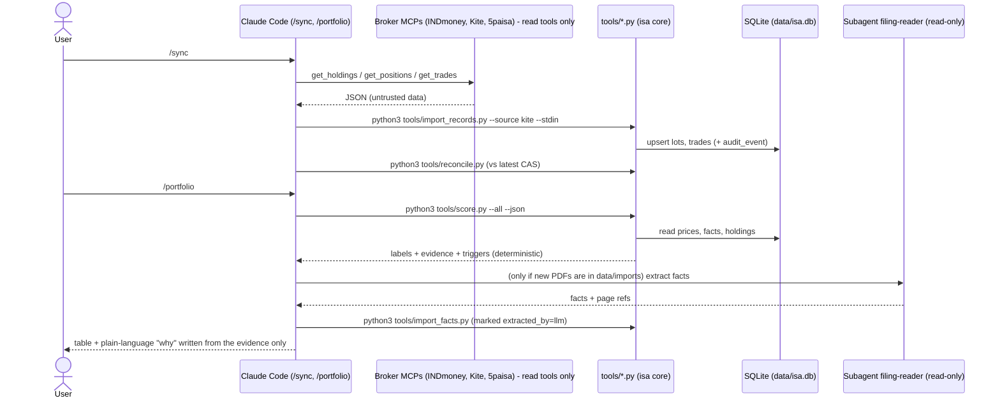

# Implementation Options

**Status:** design only, for user review (2026-11-14). No feature code.
**Question asked:** "How will this be implemented? Check multiple implementations, following ai-job-search, other code, or the Claude architecture."

Labels follow the main report:
- **[V]** = verified.
- **[A]** = assumption or judgement.
- **[U]** = not verified.

Claude facts come from Anthropic's Claude API skill reference (model table cached 2026-11-03) and Claude Code's own documentation.

---

## 1. What ai-job-search teaches (pattern study)

The `ai-job-search` repo is a **Claude Code–native workspace**: Claude is the runtime, and the repo provides instructions, tools and guardrails. Here is how each piece maps to this project:

| ai-job-search piece | What it does there | Equivalent here |
|---|---|---|
| `CLAUDE.md` | Candidate profile, workflow, verification checklist | Investor profile (long-term, no intraday), signal workflow, "never place orders", verification checklist for every signal |
| `.claude/commands/*.md` (`/scrape`, `/rank`, `/apply`, `/html-report` …) | Step-by-step orchestration prompts | `/sync`, `/analyze <stock>`, `/portfolio`, `/sell-review`, `/import`, `/thesis <stock>`, `/report` |
| `.claude/skills/<skill>/01-…md` numbered knowledge files | Domain knowledge loaded on demand | `stock-analysis/01-investor-profile.md`, `02-scoring-rubric.md`, `03-governance-red-flags.md`, `04-valuation.md`, `05-tax-rules.md` (with source URLs), `06-data-trust-boundary.md` |
| `.claude/agents/*.md` (posting-fetcher, posting-scorer, application-reviewer): read-only, tool-restricted subagents | Fan-out work, kept out of the main context | `filing-reader` (reads one downloaded annual report or results PDF and returns structured facts), `governance-checker` (related-party transactions, auditor remarks), `news-summarizer`. All are read-only with no Write tool. |
| `tools/*.py` deterministic CLIs (`rank_state.py`, `scrape_state.py`, `posting_guard.py`) | "Nothing here … judges a fit. Scoring stays with the model; this only removes the state file from the conversation." [V, `tools/rank_state.py` docstring] | **The key difference:** here, scoring **must be code**, not the model (§2) |
| `.claude/settings.json` allow / ask / deny, plus `tools/security_guards.py` in CI | Pre-approved commands; denies `.env` reads and POST curls; CI fails on permission widening | Allow only the `tools/*.py` CLIs and the broker MCP **read** tools. **Deny every order/GTT MCP tool by name.** A CI guard fails if any order tool becomes allowed. |
| State in JSON/CSV (`seen_jobs.json`, `job_search_tracker.csv`) | Simple, diffable, local | SQLite file (holdings lots, prices, facts, signals, audit). JSON/CSV is too weak for time series and audit queries. |
| `tools/jobs_dashboard.py` (stdlib local server) / `/html-report` (single HTML file) | Dashboard without a framework | `/report` builds a self-contained HTML portfolio report, or a local dashboard on 127.0.0.1 |
| `posting_guard.py`, "untrusted third-party data" trust boundary | Prompt-injection defence for fetched pages | The same rule for filings, news and MCP results: **data, never instructions** |

**The one part not to copy:** in ai-job-search, the model scores fit. For investment signals, that would make results **non-reproducible, impossible to backtest, and hard to audit** (the same inputs could give a different label tomorrow). So here:
- **Code decides** the score, the label and the triggers.
- **Claude explains, extracts and converses.**

---

## 2. Rules that hold for every option [A]

1. **Deterministic core.** Factor scores, composite, label, confidence, sell triggers, tax lots and portfolio caps are pure Python functions of stored data. Same inputs give the same output, which the backtest requires.
2. **LLM at the edges only:**
   - extracting facts from downloaded PDFs (annual reports, results, shareholding)
   - summarising news and announcements with citations
   - writing the plain-language "why" from the engine's evidence
   - answering questions
   - Every LLM-extracted number is stored with its source page and marked `extracted_by=llm` until the user confirms it.
3. **No orders anywhere** (D-04). Order tools are blocked twice: by the permission deny-list, and by the tool's own allowlist.
4. **Untrusted data boundary** for filings, news and MCP results.
5. **Secrets in the macOS Keychain**, never in `.env` or in a prompt.

---

## 3. The options

### Option A: Classic Python service (as in the current main report §5)

FastAPI + APScheduler + Postgres/Timescale + Streamlit. A Python MCP **client** pulls broker records headlessly. Claude is optional (API calls for extraction and summaries).

- **Pros:**
  - Fully unattended daily runs.
  - Deterministic.
  - No dependence on any Claude client.
- **Cons:**
  - Most code to write and run (DB container, UI, scheduler).
  - **The biggest risk:** the hosted INDmoney and Kite MCPs may not accept a non-Claude OAuth client. INDmoney says supported clients "primarily means Claude" [V, https://www.indmoney.com/mcp].

### Option B: Claude Code workspace (ai-job-search pattern)

The repo holds `CLAUDE.md`, commands, skills, subagents, `tools/*.py` and `.mcp.json`, with the three broker MCPs configured. The user runs `/sync`, `/analyze`, `/portfolio` in Claude Code (desktop or CLI). The Python CLIs do all storage and scoring.

- **Pros:**
  - **Broker MCPs work natively in Claude Code**, which is what they were built for. This removes the OAuth-client risk.
  - Smallest amount of code.
  - Same mental model as ai-job-search.
  - Covered by the user's Claude plan.
- **Cons:**
  - Runs only when the user starts a session, so no unattended daily digest.
  - Broker records pass through the model's context (holdings are small, so this is acceptable).
  - The quality of the "why" text depends on the prompts.

### Option C: Claude Agent SDK, headless on the Mac (launchd)

The same commands, skills and tools as B, but run by a small Python script using the **Claude Agent SDK** (`claude-agent-sdk`: Claude Code packaged as a library, with built-in tools, MCP servers, subagents, hooks and permissions) [V, Claude API skill reference; docs at `code.claude.com/docs/en/agent-sdk`]. launchd fires it at about 16:30 IST on weekdays. A **PreToolUse hook** denies any order tool. The results go to Telegram.

- **Pros:**
  - Unattended.
  - Reuses everything from B unchanged.
- **Cons:**
  - Usually billed through an Anthropic API key, not the Claude plan [A; confirm current terms].
  - Headless OAuth to the hosted MCPs has the same risk as A. The SDK reuses Claude Code's MCP auth, so a token saved by an interactive login may carry over [U, check in the spike].

### Option D: Messages API + Tool Runner (own agent loop)

Python `anthropic` SDK, with `client.beta.messages.tool_runner` driving a loop over our own tools (`get_holdings_from_db`, `score_stock`, …). Remote broker MCPs are attached through the API **MCP connector** (`mcp_servers` + `mcp_toolset`, beta `mcp-client-2025-11-20`) [V, skill reference].

- **Pros:**
  - Full control.
  - Approval gates through per-turn hooks.
- **Cons:**
  - Most custom agent code.
  - The broker OAuth token would have to be sent to Anthropic's API for the connector to reach the broker MCP.
  - The local 5paisa MCP cannot be reached through the connector at all.
- Not recommended.

### Option E: Claude Managed Agents with scheduled deployments (cloud)

Anthropic hosts the loop and a sandbox, and cron deployments fire sessions [V, skill reference].

**Rejected:**
- Broker sessions and portfolio data would live in a cloud sandbox.
- The local 5paisa MCP, the Keychain and the downloaded files on the Mac are out of reach.
- This conflicts with D-12 (Keychain) and D-21 (Mac only).

### Comparison

| | A: Python service | B: Claude Code workspace | C: Agent SDK headless | D: API + Tool Runner | E: Managed Agents |
|---|---|---|---|---|---|
| Broker MCP access | Custom OAuth client (risky) | **Native** | Probably reuses Claude Code auth [U] | Connector, token sent to API | Cloud only; no local 5paisa |
| Unattended daily run | Yes | No | **Yes** | Yes | Yes |
| Deterministic scoring | Yes | Yes (code in tools) | Yes | Yes | Yes |
| Code to write | High | **Low** | Low (+ about 1 script) | High | Medium |
| Fits ai-job-search habits | No | **Yes** | Yes | No | No |
| Running cost | Hosting ≈ 0 | Claude plan | API tokens | API tokens | API + sandbox |
| Data stays on the Mac | Yes | Yes | Yes | Mostly | **No** |
| Order-safety controls | Code | deny-list + CI guard | deny-list + **PreToolUse hook** | Code | Permission policy |

---

## 4. Recommendation: B now, C later, with a deterministic core [A]

**"Deterministic core, Claude shell":**
1. **Core (pure Python package `isa`)** holds the importers, SQLite storage, factor engine, tax lots, portfolio caps, backtester and HTML report. It is called as CLIs (`tools/*.py`, as in ai-job-search) and, later, as the tool's own MCP server.
2. **Shell, MVP = Option B:**
   - Claude Code commands fetch records through the broker MCPs, hand the JSON to the core CLIs, and present the core's signals with explanations.
   - Subagents read the PDFs you download.
3. **Phase 2 = Option C:** a launchd job runs the same `/sync` → `/portfolio` flow headlessly through the Agent SDK, sends the Telegram digest, and uses a PreToolUse hook as a second order-tool block.
4. **Option A's FastAPI, Streamlit and Postgres are dropped from the MVP.**
   - Storage becomes SQLite, which is enough for one user and a holdings-plus-watchlist universe (Q8).
   - The UI is a generated HTML report.
   - Revisit if the universe grows to Nifty 500.

**Why:**
- It **removes the biggest spike risk**, the non-Claude OAuth client.
- It matches the workspace pattern you already run.
- It is the least code to write.
- It keeps every number reproducible, because scoring is code.

### 4.1 How a `/sync` + `/portfolio` run works



### 4.2 Proposed repo layout (replaces main report §5.3 if approved)

```
india-stock-analyzer/
├── CLAUDE.md                     investor profile, rules (no orders, personal use), verification checklist
├── .mcp.json                     indmoney + kite (hosted, http); 5paisa (local, stdio, creds from Keychain wrapper)
├── .claude/
│   ├── settings.json             allow tools/*.py and broker read tools; DENY order/GTT tools, .env, Keychain dumps
│   ├── commands/                 sync.md, import.md, analyze.md, portfolio.md, sell-review.md, thesis.md, report.md
│   ├── skills/stock-analysis/    SKILL.md + 01-investor-profile … 06-data-trust-boundary
│   └── agents/                   filing-reader.md, governance-checker.md, news-summarizer.md (read-only)
├── src/isa/                      deterministic core: importers/, storage/, engine/, tax/, portfolio/, backtest/, report/
├── tools/                        thin CLIs over src/isa: import_records.py, reconcile.py, score.py, tax_view.py,
│                                 report.py, security_guards.py, mcp_wrap_5paisa.py
├── config/                       weights.yaml, thresholds.yaml (20%, 10%/25%), tax.yaml (s.196/s.198 + URLs)
├── data/                         git-ignored: isa.db, imports/ (manual NSE/BSE files, CAS, exports)
├── tests/                        golden tests for every factor and label; guard tests
└── scripts/launchd/              Phase 2: plist + agent_sdk_runner.py
```

### 4.3 Order-safety, layered (MVP)

1. `.claude/settings.json` `deny` lists every order or GTT tool name of each broker MCP. Kite names: `place_order`, `modify_order`, `cancel_order`, `place_gtt_order`, `modify_gtt_order`, `delete_gtt_order` [V, kite-mcp-server README]. The 5paisa names are to be listed in the spike [U].
2. `tools/security_guards.py` (copied from the ai-job-search idea) fails CI if any of those leave `deny` or appear in `allow`.
3. The 5paisa wrapper (`mcp_wrap_5paisa.py`) starts the local server with credentials from the Keychain and filters `tools/list` down to read tools. This needs a spike [U].
4. Phase 2: an Agent SDK PreToolUse hook rejects any tool whose name matches `order|gtt`.

### 4.4 Model choice [V for prices, model table cached 2026-11-03]

| Job | Model | Price per 1M tokens (in/out) |
|---|---|---|
| Interactive analysis and the "why" text (main session) | Claude Opus 5.5 (`claude-opus-5-5`), the default | $4 / $20 |
| Filing extraction and news summaries (subagents, bulk) | Claude Sonnet 5.5 (`claude-sonnet-5-5`) | $2 / $10 |
| Simple tagging (e.g. announcement type) | Claude Haiku 5.5 (`claude-haiku-5-5`) | $0.10 / $0.50 |

In Option B these run under your Claude plan. Per-token prices matter only for Option C/D API use [A]. The cheaper subagent models are a suggestion; you choose.

### 4.5 Effort (part-time) [A]

| Step | Effort |
|---|---|
| Spike: broker MCPs in Claude Code (read tools, tool names, 5paisa wrapper) | 2 days |
| Core: SQLite schema, importers (MCP JSON, CAS, CSV), FIFO lots | 1.5 weeks |
| Core: factor engine (c, d, e, f), labels, triggers, golden tests | 2 weeks |
| Workspace: CLAUDE.md, skill, 7 commands, 3 subagents, settings and guards | 1 week |
| HTML report + tax view | 0.5–1 week |
| **MVP total** | **about 5–6 weeks** (vs 6–8 for Option A) |
| Phase 2: Agent SDK launchd runner + Telegram | +1 week |

---

## 5. Decision needed

Approve **B → C with a deterministic core**? If yes, these follow-up changes are needed (none is feature code):
- **D-11 (stack):** Postgres/Timescale + FastAPI + Streamlit + APScheduler becomes SQLite + Claude Code workspace + HTML report, with the Agent SDK + launchd in Phase 2.
- **D-02 (MCP-first):** the main MCP client becomes Claude Code itself. A headless Python MCP client is needed only if Option C's auth reuse fails.
- **Main report:** §5.1–5.3 and the spike condition in §7 are updated to match.
