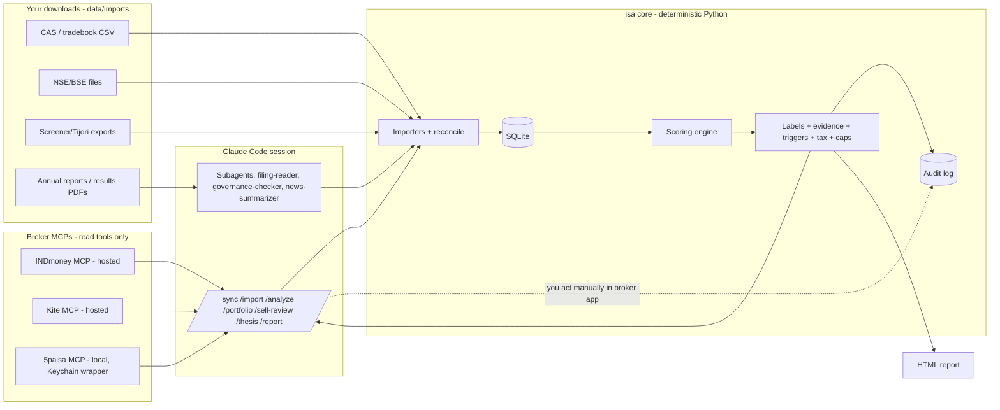

# India Stock Analyzer: Workspace Plan

**Status:** design only, no feature code. The user chose the **Claude Code workspace plan only** (2026-11-14): no headless or scheduled runs, no Agent SDK, no separate service.
**Research date:** 2026-11-14. Every link was checked on that date.
**Labels:**
- **[V]** = verified fact, with the source linked.
- **[S]** = secondary source, such as a broker blog.
- **[A]** = assumption or design judgement.
- **[U]** = not verified.

This file replaces the earlier `FEASIBILITY_AND_DESIGN.md`, `DECISIONS.md` and `IMPLEMENTATION_OPTIONS.md`, which are still in git history (commit `b603135`).

---

## 1. Goal and boundaries

A **personal-use** analysis tool for Indian equities (NSE/BSE), built for a long-term investor who never trades intraday. It reads portfolio records from **Zerodha Kite, INDmoney and 5paisa**. It outputs BUY / ACCUMULATE / HOLD / TRIM / SELL with a confidence score, a plain-language "why", sell triggers, a portfolio view and a tax view.

| Rule | Source |
|---|---|
| **Analysis only. The tool never places orders.** You place every order yourself in the broker app. | User answer Q6 |
| **Only you see the signals.** No sharing, no multi-user access, no public URLs. | User answer Q1 |
| **No automated access to NSE or BSE websites.** Exchange files are downloaded by hand. | NSE terms (§4) |
| Signals rest on market and company analysis. Technicals affect timing only. | User requirement |
| Not investment or tax advice. | — |

**User answers (2026-11-14):**
- **Q1:** only you see the signals.
- **Q2:** free Kite plan + Kite MCP first.
- **Q3:** NSE/BSE terms checked by Claude (§4).
- **Q4:** fundamentals from manual exports + filings.
- **Q5:** tax rules verified by Claude (§6).
- **Q6:** no orders, ever.
- **Q7:** use the 5paisa MCP, wrapped.
- **Q8:** holdings + watchlist only.
- **Q9:** 20% loss trigger; caps of 10% per stock and 25% per sector.
- **Q10:** runs on your Mac only.
- **Records:** "GO with MCP to fetch records".
- **Plan:** "Go with workspace plan only".

---

## 2. How it is built: Claude Code workspace + deterministic core

This follows the pattern of the user's `ai-job-search` repo:
- `CLAUDE.md` holds the profile and rules.
- Slash commands run the workflows.
- A skill holds the domain knowledge.
- Read-only subagents handle reading tasks.
- Small Python CLIs manage state.
- `settings.json` and a CI guard enforce permissions.

**The one deliberate difference [A]:** in ai-job-search, the model scores fit. Here, **code decides** every score, label, trigger, tax figure and cap, so results are reproducible, testable and backtestable. Claude's jobs are limited to:
- fetching broker records through MCP
- extracting facts from downloaded PDFs, each stored with its page reference and marked `extracted_by=llm` until you confirm it
- writing the "why" from the code's evidence only
- answering your questions

### 2.1 Components

| Piece | Contents |
|---|---|
| `CLAUDE.md` | Investor profile, the rules in §1, and a verification checklist for every signal |
| `.mcp.json` | INDmoney and Kite MCPs (hosted, http); 5paisa MCP (local, stdio, launched by `tools/mcp_wrap_5paisa.py`) |
| `.claude/commands/` | `/sync`, `/import`, `/analyze <stock>`, `/portfolio`, `/sell-review`, `/thesis <stock>`, `/report` |
| `.claude/skills/stock-analysis/` | `SKILL.md` plus `01-investor-profile`, `02-scoring-rubric`, `03-governance-red-flags`, `04-valuation`, `05-tax-rules` (with source URLs), `06-data-trust-boundary` |
| `.claude/agents/` | `filing-reader`, `governance-checker`, `news-summarizer`: read-only, with no Write tool |
| `.claude/settings.json` | Allow `tools/*.py` and broker **read** tools. **Deny** every order/GTT tool, `.env` and Keychain dumps. |
| `src/isa/` | Deterministic core: importers, SQLite storage, engine, portfolio, tax, backtest, HTML report, audit |
| `tools/` | Thin CLIs: `import_records`, `reconcile`, `score`, `tax_view`, `report`, `security_guards`, `mcp_wrap_5paisa` |
| `config/` | `weights.yaml`, `thresholds.yaml`, `tax.yaml` (rates with source URL and effective date) |
| `data/` (git-ignored) | `isa.db` (SQLite) and `imports/` (your manual downloads) |

**Stack [A]:**
- Python 3.12 (uv) and SQLite.
- A generated self-contained HTML report.
- Secrets in the macOS Keychain.
- Models: Claude Opus 5.5 for the main session; Sonnet 5.5 or Haiku 5.5 for the extraction subagents (your choice). Everything runs under your Claude plan.

### 2.2 Flow

**A typical session:**
1. Open the repo in Claude Code and sign in to the broker MCPs (sessions expire daily).
2. `/sync` reads holdings, positions and trades and passes the JSON to `tools/import_records.py`.
3. `/import` loads new files from `data/imports/`. The subagents extract facts from PDFs.
4. `/portfolio` runs `tools/score.py` and shows each label with its confidence, "why", triggers and tax view.
5. Record what you decided. You place any order in the broker app yourself.

### 2.3 Order safety, in layers

1. `settings.json` denies every order and GTT tool by name. Kite's are `place_order`, `modify_order`, `cancel_order`, `place_gtt_order`, `modify_gtt_order`, `delete_gtt_order` [V, https://github.com/zerodha/kite-mcp-server]. The 5paisa names are to be listed in the spike [U]. INDmoney is read-only by design [V].
2. `tools/security_guards.py` fails CI if any of those tools leaves `deny` or appears in `allow`.
3. The 5paisa wrapper filters the server's tool list down to read tools.
4. The audit log records any blocked order-tool attempt.

---

## 3. Broker access (verified)

| | Zerodha Kite | 5paisa | INDmoney |
|---|---|---|---|
| Official MCP | Hosted `https://mcp.kite.trade/mcp`, free, Kite 2FA login; also self-hostable (MIT) [V] | **Local** (`github.com/5paisa/5paisa_MCP`, Node), free; "place orders, check your portfolio, or fetch market data" [V] | Hosted `https://mcp.indmoney.com/mcp`, "Read-only by design", OAuth 2.1 + PKCE, free [V] |
| MCP read tools | `get_holdings`, `get_positions`, `get_mf_holdings`, `get_trades`, `get_orders`, `get_ohlc`, `get_historical_data`, `get_quotes`, `search_instruments` [V] | Not listed publicly [U] | Holdings with P&L and XIRR, net worth, OHLC candles, live prices [V] |
| Caveat | The hosted endpoint "excludes potentially destructive trading operations". Zerodha's 2025 post says read-only "except for GTT orders". The two sources conflict [U]. | The setup guide stores the TOTP secret and PIN in a plain `creds.json`, so the wrapper must inject them from the Keychain instead [V] | Supported clients: "primarily means Claude" [V] |
| REST API (fallback) | Personal plan free; Connect ₹500/mo for historical data and WebSocket; token expires "6 AM on the next day" [V] | Free Xstream API; token "expires every day at 11:59 PM" [V] | None found [V for absence of evidence] |

**Sources:**
- Kite: https://github.com/zerodha/kite-mcp-server · https://zerodha.com/z-connect/featured/connect-your-zerodha-account-to-ai-assistants-with-kite-mcp · https://zerodha.com/products/api/ · https://kite.trade/docs/connect/v3/user/
- 5paisa: https://www.5paisa.com/technology/mcp-ai-trading-assistant · https://www.5paisa.com/mcp-ai-trading-assistant-setup-for-mac · https://xstream.5paisa.com/dev-docs/user-authentication-system/access-token
- INDmoney: https://www.indmoney.com/mcp

**Kite terms** [V, https://kite.trade/terms]:
- Personal use means "a private interface exclusively for customising personal trading and investment experience".
- Live data "cannot be displayed to the public at large".
- No databases or caches built for redistribution.
- Logs must be kept "for at least 5 years".

**Integration order:**
1. INDmoney MCP.
2. Kite MCP.
3. 5paisa MCP (wrapped), in Phase 2.
4. **CDSL/NSDL CAS import** to reconcile quantities across all demats [A]. INDstocks is CDSL DP 12095500 [V].

Tradebook CSVs and contract notes are the fallback for buy dates and prices.

---

## 4. Data sources and terms

**NSE terms** [V, https://www.nseindia.com/nse-terms-of-use, updated 29/10/2025]:
- "User is prohibited to conduct any systematic or automated data collection activities (including scraping, data mining, data extraction and data harvesting)".
- No copying or storing content "without prior written permission of NSE". The only carve-out: "Unless the information or Content is available for download".
- No use "for any gaming, virtual trading or simulation activities".

**BSE** [S, via search]:
- Its disclaimer prohibits "Any reproduction, redistribution or transmission" (https://www.bseindia.com/rgess/disclaimer.htm).
- BSE Plus terms forbid "regularly or systematically downloading and storing" pages (https://bseplus.bseindia.com/Terms_condition_Bseplus.htm).

**Screener and Tijori** [V]:
- Personal, non-commercial use only. No copying or mirroring.
- Sources: https://www.screener.in/guides/terms/ · https://www.tijorifinance.com/terms-of-use

| Data | Source | How it gets in |
|---|---|---|
| Prices for holdings and watchlist | Broker MCPs (Kite `get_historical_data`/`get_ohlc`, INDmoney OHLC) | `/sync` |
| Fundamentals | Your own Screener/Tijori exports; results and annual-report PDFs you download | `/import` (subagents extract facts from PDFs) |
| Shareholding, pledges, corporate actions | Exchange files you download each quarter | `/import` |
| Policy rates and INR | RBI homepage: repo 5.50%, FBIL ₹94.1997/USD on 13 Nov 2026 [V, https://www.rbi.org.in/] | Entered or imported at most daily; RBI terms [U] |
| Index valuation, FII/DII, India VIX | Manual downloads (niftyindices terms [U]) | `/import` |
| Backtest history | **Broker-supplied history only**, because NSE bars "simulation" use | Phase 3 |

The paid upgrade path, if manual imports become a burden, is TrueData or Global Datafeeds, both authorised exchange data vendors. Their prices were not verified [U].

---

## 5. Scoring engine (deterministic) [A]

Each block scores from −2 to +2 and carries `evidence[]` (metric, value, comparison, data date) and a `data_completeness` value.

| Block | Inputs | Weight |
|---|---|---|
| (a) Market/macro | Nifty 50/500 vs 200DMA, breadth, sector rotation, FII/DII, repo trend, INR, crude, India VIX, Nifty P/E percentile | 10% (Phase 2) |
| (b) Sector | Growth outlook, cyclicality, regulatory risk, rank vs peers | 10% (Phase 2) |
| (c) Fundamentals | 3y/5y revenue, PAT and EPS CAGR; ROE, ROCE, margins, D/E, interest coverage, FCF, CFO/PAT, working capital, dividends | 30% |
| (d) Governance | Promoter holding and pledge trend, FII/DII/MF change, related-party transactions, auditor remarks and resignations, dilution | 20% + **veto** on BUY/ACCUMULATE |
| (e) Valuation | P/E, P/B, EV/EBITDA, PEG vs own history and peers; intrinsic value range with stated assumptions | 20% |
| (f) Technicals | 50/200 DMA, RS vs index, support and resistance, volume, drawdown | **0%**: changes timing only (e.g. stagger entry) |
| (g) Events | Results vs trend, guidance changes, corporate actions, news tone | 10% (Phase 2) |

- **Label:** composite ≥ +1.0 BUY · +0.4 to +1.0 ACCUMULATE · −0.4 to +0.4 HOLD · −1.0 to −0.4 TRIM · ≤ −1.0 SELL.
- **Confidence** = data completeness × agreement between blocks × freshness.
- **"Why"** = the top 3 positive and top 3 negative evidence lines.

**Sell triggers:**
1. **Thesis broken:** a condition you wrote fails.
2. **Valuation:** price is more than 30% above the upper intrinsic value.
3. **Loss:** down **20%** *and* the fundamentals score fell over 2 quarters. A loss alone never triggers a sell.
4. **Better opportunity:** a stronger stock elsewhere beats the holding *after* tax.

**Portfolio view:** caps of **10% per stock and 25% per sector**, top-5 concentration, sizing by conviction and volatility, and rebalancing flags.

**Backtest (Phase 3):**
- Monthly walk-forward rebalancing.
- Fundamentals used only from their `published_at` date.
- Adjusted prices; no survivorship bias.
- Out-of-sample test from 2021.
- Costs and taxes included.
- Metrics: CAGR, max drawdown, hit rate vs Nifty 500 TRI.

---

## 6. Tax (verified on incometaxindia.gov.in)

- **Income-tax Act, 2025, s.196:** STCG on equity where the sale "is chargeable to securities transaction tax" is taxed "at the rate of 20%" [V, https://www.incometaxindia.gov.in/w/section-196-76].
- **s.198:** LTCG where STT has "been paid on acquisition and transfer" is taxed on gains "exceeding Rs. 125000 at the rate of 12.5%" [V, https://wm.incometaxindia.gov.in/w/section-198-78]. These replace s.111A and s.112A with the same rates [V, https://www.incometaxindia.gov.in/sale-of-shares].
- **Long-term** after 12 months [V, via official notification search result]. Demat lots follow **FIFO**; the transfer date is the broker's note date [V, sale-of-shares page].
- **Engine behaviour:**
  - Post-tax proceeds per lot.
  - A "wait until <date>" note when a lot turns long-term within 30 days and no thesis break fired.
  - Tracking of the ₹1.25 lakh exemption used this financial year.
- **Not verified, so off in the MVP** [U]: loss set-off and carry-forward, the 31 Jan 2018 grandfathering, STT rates. The MVP shows gross gains only.

---

## 7. Compliance (verified)

- **Investment Adviser:** "any person, who **for consideration**, is engaged in the business of providing investment advice **to clients**". General market comments that do not name securities are exempt (Reg. 4(a)) [V, SEBI IA Regulations amended up to 25 Nov 2025, https://www.sebi.gov.in/sebi_data/attachdocs/aug-2026/1785912187595.pdf].
- **Research Analyst:** RA Reg. 2(u) covers people preparing or publishing research reports or buy/sell/hold recommendations [S, via search summary of https://www.sebi.gov.in/sebi_data/commondocs/RESEARCHANALYSTS-regulations_p.pdf].
- **Reading [A, not legal advice]:**
  - Analysing for your own money is outside both definitions.
  - Sharing signals with others could need registration, which is why the plan has no sharing features.
- **Retail algo framework:**
  - Requires exchange-tagged algo IDs, "static IP whitelisted by the broker", OAuth and 2FA [V, SEBI circular 4 Feb 2025, https://www.sebi.gov.in/sebi_data/attachdocs/feb-2025/1738665456458.pdf].
  - It became "applicable for all stock brokers" from 1 April 2026 [V, SEBI circular 30 Sep 2025, https://www.sebi.gov.in/sebi_data/attachdocs/sep-2025/1759232056254.pdf].
  - Because the tool **places no orders**, the framework does not apply to it [A].
- **Security:**
  - Secrets (5paisa TOTP seed and PIN) live in the Keychain.
  - Claude Code holds the hosted-MCP sign-ins.
  - `.env` holds no secrets and Claude is denied access to it.
  - Nothing listens on the network.
  - Append-only audit log of signals, syncs, decisions and blocked order-tool calls, kept for 5 years or more.

---

## 8. Roadmap [A, part-time estimates]

| Phase | Scope | Effort | Main risks |
|---|---|---|---|
| **Spike** | In Claude Code: connect the INDmoney and Kite MCPs, record the exact order/GTT tool names for the deny-list, test the 5paisa wrapper with Keychain credentials | 2 days | Hosted Kite tool set; 5paisa may require `creds.json` (fallback: 5paisa read-only REST) |
| **MVP** | `CLAUDE.md`, skill, 7 commands, 3 subagents, settings and guards; `/sync` from INDmoney and Kite; CAS and CSV import; SQLite schema; FIFO lots; prices via MCP; import folder; blocks (c), (d), (e), plus (f) for timing; labels with "why"; thesis, valuation and 20%-loss triggers; 10%/25% caps; gross STCG/LTCG view; HTML report; audit log | 5–6 weeks | Manual import effort; daily broker sign-in; PDF extraction errors (mitigated by page references and your confirmation) |
| **Phase 2** | 5paisa MCP; macro (a), sector (b) and events (g) blocks; peer comparison; rebalancing; better-opportunity trigger with tax; DCF ranges; loss set-off once verified | 5–6 weeks | Macro data gaps (crude); peer classification quality |
| **Phase 3** | Backtester on broker history, weight calibration, news summaries with citations, optional paid fundamentals vendor | 6–8 weeks | Point-in-time fundamentals history |

Everything runs inside a Claude Code session that you start. There are no scheduled or unattended runs and no push alerts. That is the trade-off of the workspace-only plan.

---

## 9. Key decisions

| # | Decision | Reason |
|---|---|---|
| 1 | Claude Code workspace + deterministic Python core, SQLite, HTML report; nothing else | User choice; broker MCPs work in Claude Code without extra setup; least code |
| 2 | Broker records through official MCPs; CAS, CSV and contract-note imports as fallback | User direction; INDmoney has no public API |
| 3 | No orders in any phase; order tools blocked in layers | User answer Q6; keeps the tool outside the algo framework |
| 4 | Code decides labels, Claude explains | Reproducibility and backtesting |
| 5 | Governance red flags veto BUY/ACCUMULATE | Asymmetric downside for long-term holders |
| 6 | No automated NSE/BSE access; manual downloads only | NSE terms |
| 7 | Tax rates in config with URLs; gross gains until set-off is verified | Rates change with budgets |
| 8 | Secrets in the Keychain; no sharing; nothing listening on the network | Security and the SEBI IA/RA boundary |

## 10. Verdict: **GO-WITH-CONDITIONS**

1. The spike confirms the broker MCP read tools and the exact order-tool names, and that 5paisa runs without a plaintext credentials file.
2. Exchange data comes in only through manual downloads.
3. Tax suggestions use only the verified rules (s.196 and s.198).
4. Personal use only, and no orders.

**Still open (to settle in the spike or later):**
- Which tools the hosted Kite MCP exposes today.
- The 5paisa MCP tool names and credential handling.
- niftyindices and RBI terms.
- Loss set-off, grandfathering and STT rules.
- The exact orders-per-second threshold. It is not needed while the tool places no orders.
